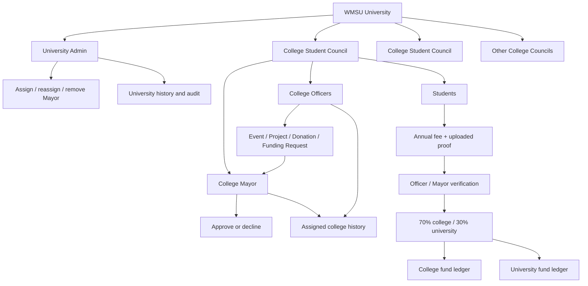

# WMSU University-Wide Student Council Funds Management System

## Scope

The application is being expanded from a single-council ledger into a university-wide system. The database name remains `student_council_funds`. Existing core financial tables are retained as a compatibility foundation.

## Conceptual framework

## Account responsibilities

- **Student:** view and edit permitted own-profile fields; view enrollment year, announcements, annual fees, payment status, and own payment history; upload proof for own fee records. No financial editing or announcement publishing.
- **Admin:** university-wide access, Mayor assignment/reassignment/removal, all-college requests and history, university-wide announcements, and legacy finance administration.
- **Mayor:** full college-scoped management of budgets, fund sources, collections, projects, and expenses; officer assignments; request approvals; college announcements; payment verification; and audit/history view for own college. Every CRUD list, record lookup, and foreign-key dropdown is scoped server-side to the assigned college.
- **Officer:** publish announcements for own college, submit requests to the Mayor, verify payment proof for own college, and view college transaction history. Officers cannot directly allocate funds.

## Student registration and enrollment

1. Student enters first name, optional middle name, last name, and optional suffix.
2. Student selects a college first; the program dropdown is then enabled with active programs associated with that college. Admin can add or deactivate catalog entries in `catalog.php`; the initial seed list must still be checked against the Registrar prospectus.
3. Student enters student number, year level, school year, contact number, and official WMSU email.
4. A one-time code is sent to the configured WMSU email domain.
5. Successful email verification activates the account and records a school-year enrollment snapshot. Admin can add subsequent annual enrollment snapshots in `enrollments.php` without overwriting prior years.

Email verification proves access to the mailbox, not necessarily current enrollment. If inactive/alumni mailboxes remain usable, use an authorized Registrar roster or integration before financial certification.

## Annual fees and distribution

| Fee | Amount | College 70% | University 30% |
|---|---:|---:|---:|
| Insurance | PHP 70.00 | PHP 49.00 | PHP 21.00 |
| CSC payment | PHP 200.00 | PHP 140.00 | PHP 60.00 |
| Total | PHP 270.00 | PHP 189.00 | PHP 81.00 |

The payment page creates annual requirements for a student's school year. Students upload JPG, PNG, or PDF proof (maximum 5 MB). The Officer/Mayor checks the proof against the physical record and verifies or rejects it. Verified payments create a separate 70/30 distribution row and a verification log. The 30% share is posted once to the Admin-only university fund ledger; the college history records only the 70% share. Gross payment is not counted twice.

## Request and spending workflow

1. Officer submits an Event, Project, Donation, or Funding request under their own college and school year.
2. The assigned Mayor approves or declines the request, with a reason required for a decline.
3. The Mayor creates a college budget and links a project to an approved request from the same college and school year. Project allocation cannot exceed the remaining budget.
4. Expenses reference an approved-request project, category, voucher, date, amount, and responsible officer; expense entry cannot exceed the remaining project allocation.

## School-year and history rules

Enrollment and payment records carry school year. Requests carry college and school year. Legacy collection and expense rows gain college/school-year snapshots; new rows created through the legacy Admin CRUD save those snapshots. Admin can filter university history by college/date/school year. Mayor and Officer history is restricted server-side to their assigned/student college and can be filtered by date and school year. Old rows are retained; the best available current student/project information is used to backfill older snapshots where possible.

## Logical relationships

- `college` 1-to-many `program_catalog`
- `student` 1-to-many `student_enrollment` (Admin can record new school-year snapshots without overwriting prior years)
- `student_payment` references a fee requirement and school year; `payment_proof` records uploaded evidence
- `student_payment` 1-to-1 `fund_distribution` once verified; the university share is also posted to `university_fund_ledger`
- `college` 1-to-many `college_mayor` assignment history
- `college` 1-to-many `announcement`; NULL college scope means university-wide
- `fund_request` carries requesting account, college, school year, type, and decision metadata
- `audit_log` records account, college, action, entity, and timestamp
- `officer` remains linked to `student`; active officer terms define who can verify payments and submit requests

## Security and deployment notes

- Keep database name `student_council_funds` unchanged.
- Migrations are additive and do not drop existing tables.
- Use prepared statements, CSRF protection, password hashing, escaped output, and server-side college authorization.
- Payment proof files are stored under `uploads/payment-proofs` with direct directory access denied; use the authorized `payment-proof.php` route.
- The university-wide legacy ledger remains Admin-only. Mayor access to financial CRUD uses college-scoped predicates on records and dropdowns; do not remove those checks or replace them with client-provided college IDs.
- Back up the database and test migrations, roles, payment uploads, and request decisions on test accounts before using real funds.
